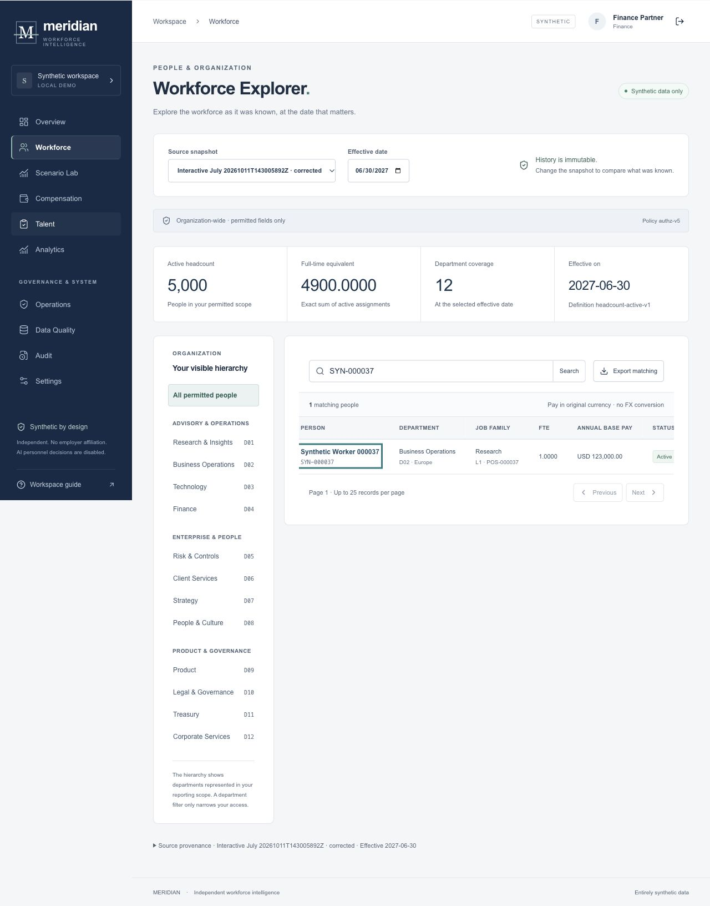
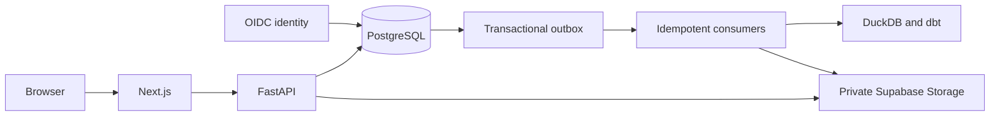
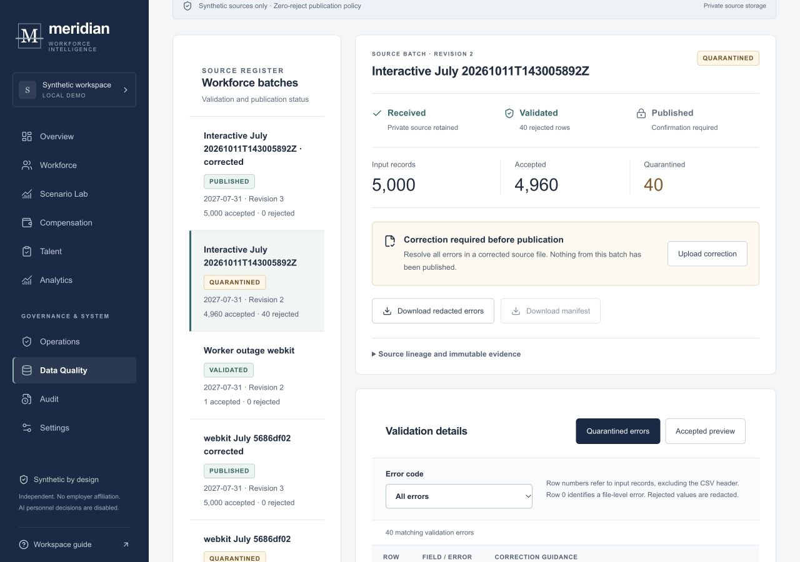
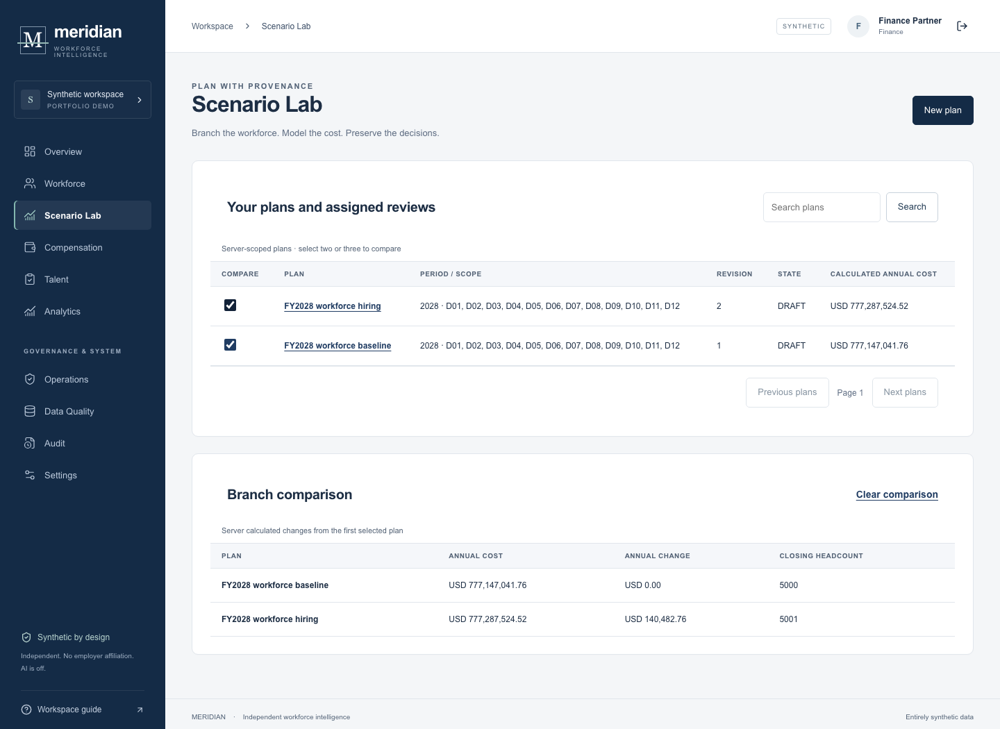
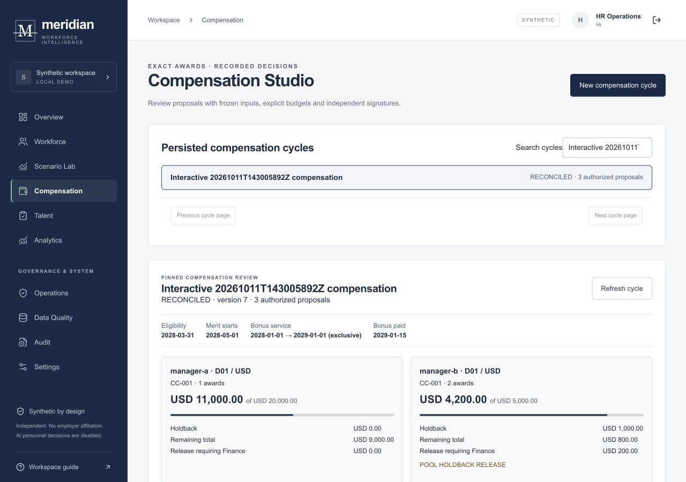
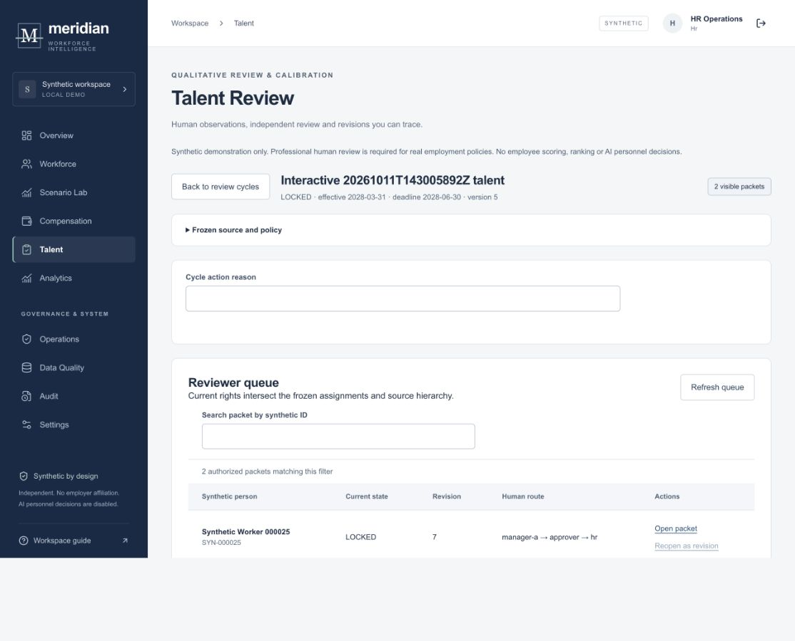
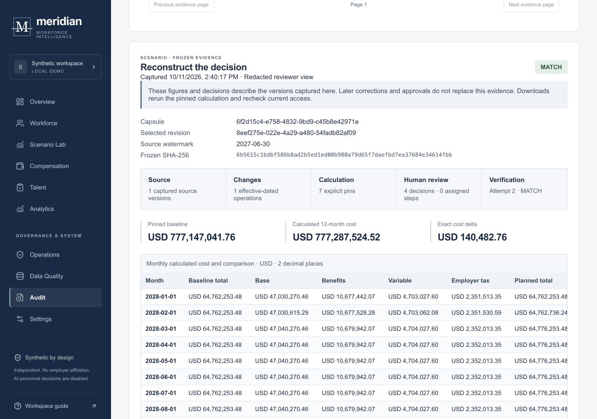
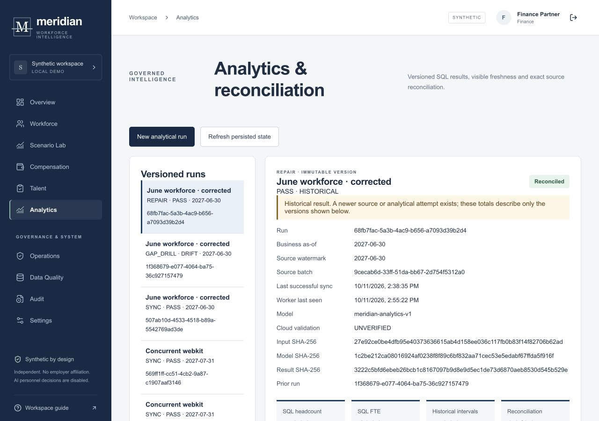
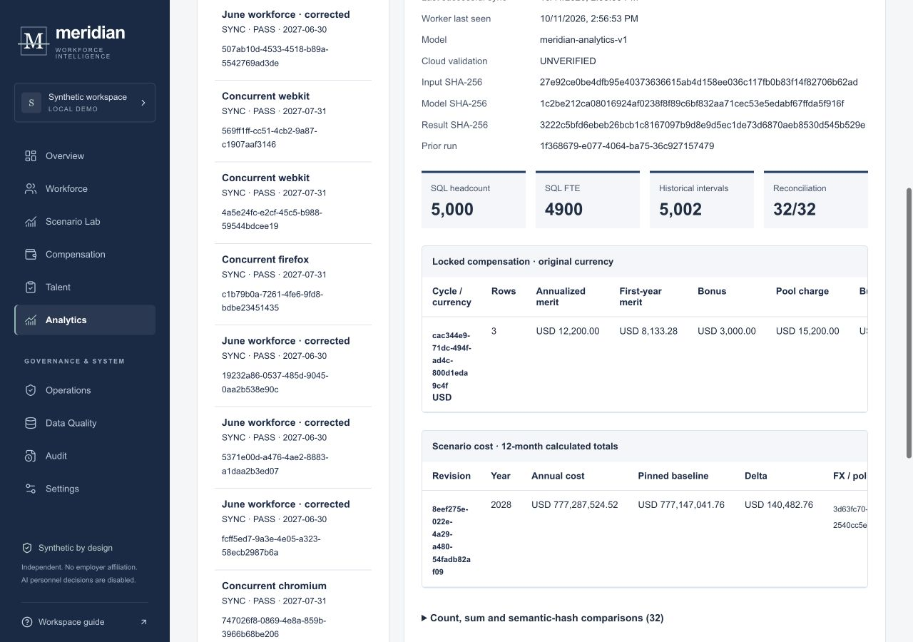

# Meridian

Meridian is a workforce planning and compensation system that can reproduce a financial decision from the source data, assumptions, revisions, and approvals behind it.

[Live Demo](https://meridian-workforce.vercel.app) | [Architecture](#architecture) | [Demo Guide](docs/REVIEWER_GUIDE.md) | [System Design](docs/SYSTEM_DESIGN_CASE_STUDY.md) | [Security](SECURITY.md)

Independent synthetic portfolio project.

Workforce plans need a reliable history: what was known at the time, what changed, who approved which version, and whether the result can be reproduced later. **Decision Replay** rebuilds that result from pinned evidence.

For a February 29, 2028 hire, the verified twelve-month scenario is:

| Baseline | Planned | Difference |
| --- | --- | --- |
| USD 777,147,041.76 | USD 777,287,524.52 | **USD 140,482.76** |

Meridian reproduces the difference from the source snapshot, effective dates, hire operation, currency rules, and review decisions.

**Source feed → quarantine and correction → sealed workforce snapshot → Scenario Lab → financial result → approvals → compensation → DuckDB/dbt analytics → Decision Replay**





## Why Meridian exists

Source records arrive late. Effective dates can differ from the date a correction was recorded. A manager can revise a proposal after it is returned. Those changes must not rewrite the evidence behind an earlier decision. Meridian keeps each version and makes the calculation reproducible.

## What it does

A steward imports 5,000 synthetic rows, sees 40 quarantined defects, corrects them, and publishes a sealed snapshot. HR and Finance use that snapshot to compare budget branches. Managers and reviewers run versioned compensation and talent cycles. DuckDB/dbt reconciles governed exports. Decision Replay connects a financial delta to its inputs and human decisions.



## Scenario Lab

Create branches for hires, exits, transfers, and merit changes. Each revision pins its workforce snapshot, FX rates, policy, and calculation version. Authoritative money calculations use decimal arithmetic, explicit currencies, and defined rounding.

Business effective time is separate from source-recording time. A later correction can update today's view without changing the version a reviewer used earlier.



## Compensation Studio

Review cycles pin the workforce snapshot, guideline version, eligibility, ownership, and budgets. Managers propose awards and explain exceptions. Reviewers return or approve a specific revision. A returned proposal creates a new revision and invalidates approval authority for the old one. HR and Finance sign the current version before the cycle locks and exports.

Locked awards cannot be edited, and nobody can approve their own proposal. The verified three-award export totals USD 15,200.00.



Qualitative talent reviews use the same revision, signature, and lock discipline.



## Decision Replay

**Source snapshot + effective dates + scenario operations + FX and currency rules + policy and model versions + event history + human approvals = reproducible financial result.**

A replay records the evidence behind a result, then verifies it again. **MATCH** means the reconstructed evidence and result agree. **MISSING** means a required input is absent. **CORRUPT** means an integrity check failed. Replay keeps failures visible and never swaps in newer inputs to force a match.

Historical evidence stays immutable. Current permissions still control who can retrieve it. Auditor views retain provenance while withholding individual pay and review narratives.



## Architecture

The browser talks to Next.js, which forwards typed requests to FastAPI. PostgreSQL is the transactional source of truth. Alembic manages schema changes. API, worker, and identity services use separate database roles. The browser has no direct access to business tables.

A transactional outbox delivers work at least once. Consumers record idempotent receipts, so a retry after a worker restart or an object write cannot create a second result. DuckDB/dbt builds derived analytical exports and checks them against source totals. Hosted configuration uses private Supabase Storage; local development keeps the filesystem adapter.





## Security and authorization

OIDC uses PKCE, state, nonce, and issuer and audience checks. Synthetic accounts receive separate generated passwords. Current grants live in PostgreSQL; the client cannot switch roles. Each artifact download request checks current server-side authorization and validates an expiring, session-bound link. Runtime database roles cannot run migrations.

No real employee data is connected. AI is OFF.

## Failure and recovery behavior

Work remains in PostgreSQL until a consumer acknowledges it. Duplicate delivery is safe. If a worker exits after writing an object but before recording the acknowledgement, it verifies and reuses the same bytes on retry. A corrupt object fails closed.

Analytics drift stays unpublished until a rerun matches its pinned source. Local tests cover worker termination and restart, database reconnect, migration rollback and restore, and reconciliation. Hosted recovery results are reported separately below.

## Verification

The [public main CI run](https://github.com/upcomingsimplecoder/meridian-workforce-portfolio/actions/runs/38257301139) passed all required jobs:

| Check | Result |
| --- | --- |
| Python domain and analytics | 807 passed |
| PostgreSQL identity | 18 passed |
| Frontend | 60 passed |
| Browser E2E | 117 passed across three engines |
| OIDC and clean demo setup | 12 passed |
| DuckDB/dbt | One model and five data tests passed |

The worker-kill drill stopped a consumer after it wrote an export but before acknowledgement. Retry recovered one artifact and one receipt. Migration, database reconnect, isolated restore, independent financial-oracle, and reconciliation tests also ran. See the [audit summary](docs/PUBLIC_AUDIT_SUMMARY.md) for the exact evidence and hosted-test boundary.

Hosted ingestion, a returned scenario, and repeated Decision Replay have been observed against persisted state. The complete hosted workflow, recovery, and manual keyboard acceptance remain open. The audit summary records that boundary.

## Run locally

Install Node 24, Python 3.12, and PostgreSQL 17. Then run:

```sh
make demo
```

Open http://127.0.0.1:3017. Setup applies migrations, creates 5,000 fictional people, and starts the web app, API, identity service, and two worker processes. Generated passwords are written to the ignored, mode-0600 `.local/demo-credentials.json` file.

```sh
make test
make analytics
npm run e2e
make down
```

`make down` keeps the database and artifacts. See the [development guide](docs/DEVELOPMENT.md).

## Deployment

The live frontend is [meridian-workforce.vercel.app](https://meridian-workforce.vercel.app). The API readiness endpoint is [meridian-api-icc5.onrender.com/ready](https://meridian-api-icc5.onrender.com/ready), and the synthetic OIDC issuer is [meridian-identity-3g3y.onrender.com](https://meridian-identity-3g3y.onrender.com/.well-known/openid-configuration). Vercel and both Render services deployed from `main` at `76c10ebeb7d7170cc47d36bca8bfe8d763f123fc`.

Supabase hosts the transactional database and private `meridian-artifacts` bucket. The free Render option runs the outbox/export and analytics consumers as supervised processes beside the API. Their heartbeat rows were current in the recorded database check. They share memory and availability, and the services can sleep. DuckDB/dbt powers the analytical implementation. Snowflake is not required or live.

## Repository structure

```text
apps/web/          Next.js and strict TypeScript
apps/api/          FastAPI domains and Alembic migrations
apps/identity/     Synthetic OIDC provider
apps/worker/       Outbox and analytics consumers
analytics/         DuckDB, dbt, and reconciliation
packages/contracts/ Generated API types and event schemas
tests/             API, domain, and browser tests
infra/             Local and hosted runtime configuration
docs/              Guides, ADRs, and concise audit summary
```

## Limitations

The free Render services may sleep and have limited memory. Full hosted workflow, recovery, and keyboard acceptance are incomplete. The project does not claim production scale, enterprise MFA, compliance certification, penetration testing, payroll integration, or live Snowflake.

## About the project

Meridian is an independent portfolio project. It is not affiliated with any employer. All people, organizations, compensation figures, and workflows in the demo are synthetic.

Project code is licensed under MIT. Third-party dependencies retain their own licenses. See the [portfolio one-pager](PORTFOLIO_ONE_PAGER.md) and [interview brief](INTERVIEW_BRIEF.md).
