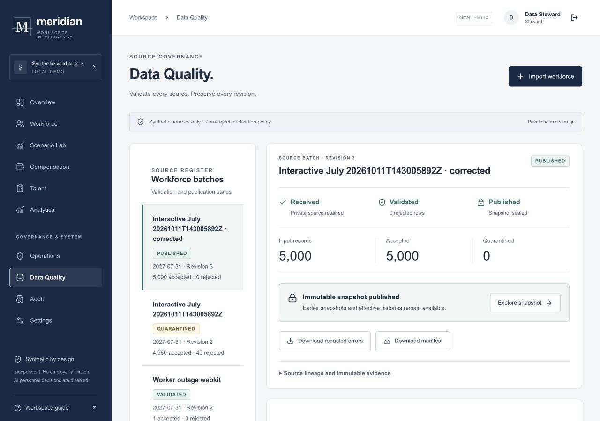
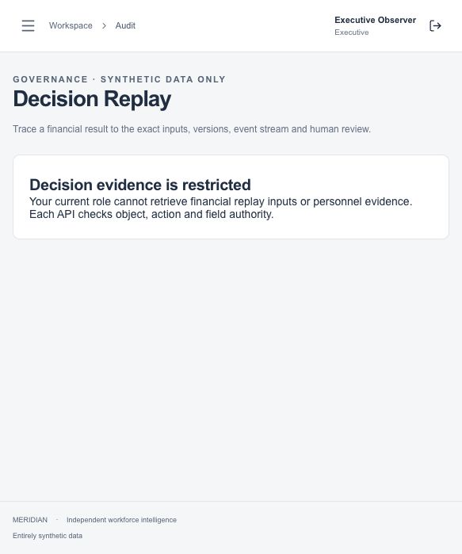
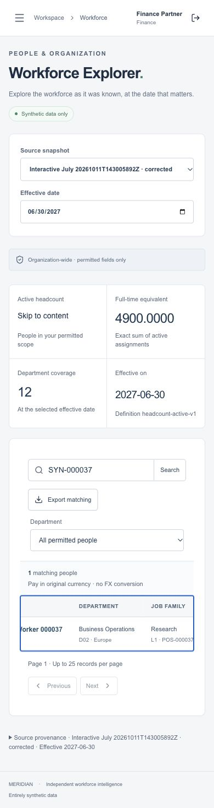

# Meridian demo guide

This guide walks through the complete synthetic Meridian demo. It explains
which account to use, what to click, what should be saved, and how to check
the important negative cases. The screenshots are selected product captures
from persisted local workflows. They show the shape of the finished product;
the verification notes below identify which observations were hosted and
which were local.

[Open the hosted demo](https://meridian-workforce.vercel.app) ·
[API readiness](https://meridian-api-icc5.onrender.com/ready) ·
[OIDC metadata](https://meridian-identity-3g3y.onrender.com/.well-known/openid-configuration)

Independent synthetic portfolio project. Do not enter real people or company
data.

## A quick tour

For a short review, sign in as `steward`, open **Workforce**, then visit the
following pages from the left navigation:

1. **Workforce** shows the effective-dated source view and the 5,000-row
   synthetic snapshot.
2. **Scenario Lab** shows the pinned source, assumptions, branches, and exact
   twelve-month cost.
3. **Compensation** shows a versioned review with a returned proposal and a
   locked export.
4. **Analytics** shows a DuckDB/dbt run and its reconciliation table.
5. **Audit** opens Decision Replay, where the calculation can be checked again
   from frozen inputs.


The verified leap-day example is the easiest way to recognise the correct
dataset:

| Baseline | Planned | Difference |
| --- | --- | --- |
| USD 777,147,041.76 | USD 777,287,524.52 | **USD 140,482.76** |

## Accounts and setup

Each account has a server-controlled grant. Sign out before switching
accounts. The browser cannot change a role in the page.

| Account | Use it for |
| --- | --- |
| `steward` | Import, quarantine, correction, and publication |
| `hr` | Workforce, review-cycle controls, and HR signatures |
| `finance` | Scenario planning, financial sign-off, and governed exports |
| `manager-a` | Research manager proposals and observations |
| `manager-b` | Operations scope denial checks |
| `approver` | Independent Research review and calibration |
| `executive` | Governed aggregates only |
| `auditor` | Redacted evidence and provenance |

### Hosted sign-in

Open the hosted demo from its root URL and select **Sign in to Meridian**.
Use the synthetic credentials supplied for the review. Passwords are not
stored in this repository. Render free services may sleep, so the first
request can take a minute. If the sign-in page reports an expired interaction,
return to the root demo URL and begin again.

Do not bookmark a generated OIDC interaction URL. A copied URL ending in
`/interaction/<id>/login` now redirects to the canonical interaction page,
but an expired interaction still needs a new sign-in. This keeps a stale link
from becoming a confusing 404 while preserving the server-side session check.

### Local sign-in

For the complete repeatable walkthrough, use the local stack:

```sh
make demo
```

Open <http://127.0.0.1:3017>. The setup creates a fresh PostgreSQL database,
applies migrations, loads the fictional workforce, and starts the API,
identity service, outbox consumer, and analytics consumer. Generated
passwords are written to the ignored, mode-0600
`.local/demo-credentials.json` file.

Useful commands after the walkthrough:

```sh
make test
make analytics
npm run e2e
make down
```

`make down` stops project processes and keeps the local database and artifact
files for inspection.

## 1. Ingest, correct, and publish a workforce source

Use `steward`. This is the source-governance path, so every step should leave
an observable row in the source register.

1. Open **Data Quality** and choose **Import workforce**.
2. Select `fixtures/workforce/quarantine-40.csv`.
3. Enter a source title and watermark, then submit the import. Wait for the
   batch to move from validation to its saved result.
4. Open the batch. The expected result is **4,960 accepted** and **40
   quarantined**. Read the error list rather than hiding it. Names and IDs in
   the fixture are fictional.
5. Choose the correction action, select
   `fixtures/workforce/corrected.csv`, and submit it as a revision of the
   quarantined batch.
6. Select the corrected revision and choose **Publish**. Confirm the warning
   only after the accepted count is **5,000** and the rejected count is zero.
7. Open **Workforce**. Search for the new watermark in **Search published
   sources**, choose **Find source**, and check the effective date and source
   revision in the page header.




What to check:

- The original quarantine remains in the register after publication.
- The published snapshot has a stable source ID and SHA-256 fingerprint.
- A second publish attempt is rejected instead of creating a new mutable
  version.
- The workforce page reads from the published snapshot, not from the upload
  form.

## 2. Explore workforce history

Use `hr`, `finance`, or `steward`.

1. Open **Workforce** and choose the published source from the source picker.
2. Set the business effective date to the date used by the snapshot. The
   business date is different from the time the source row was recorded.
3. Search for a synthetic ID or department. Use the table's pagination and
   horizontal scroll to inspect the effective-dated fields.
4. Select **Export matching** only within the account's permitted scope.
   The server rechecks the grant when the download is issued.

The saved view should show 5,000 active people, 4,900.0000 FTE, and twelve
departments for the verified July 2027 snapshot.

## 3. Build and review a financial scenario

Use `finance` to create the plan and `hr` as the separate reviewer.

1. Open **Scenario Lab** and choose **Create a plan**.
2. Set the base snapshot to the June or July published source used by the
   fixture. Select the displayed cost-policy and FX versions. Choose `hr` as
   the assigned reviewer and select the departments in scope.
3. Set forecast year to 2028, enter the planning date, and enter the budget
   cap in reporting minor units. The form expects integer cents for USD.
4. Choose **Create pinned plan**. The saved plan should show its source,
   policy, FX, reviewer, and calculation version before any operation is
   added.
5. In **Add an operation**, choose **Hire**. Use a new synthetic employee ID,
   position ID, department, grade, annual pay of `12000000` USD cents, and
   `1.0000` FTE. Set the effective date to **2028-02-29** and give the
   change a reason.
6. Add the planned merit or bonus assumption used by the fixture, then save
   the operation. The server calculates the twelve monthly rows and stores a
   new revision.
7. Create a second branch from the same pinned source. Change one assumption
   so the comparison has a visible but explainable delta.
8. Select both branches and choose **Compare**. The leap-day branch should
   reproduce the values at the top of this guide, including the exact
   difference of **USD 140,482.76**.
9. Submit the selected plan to `hr` with a reason. Switch to `hr`, open the
   assigned review, and approve or return the current revision. The original
   revision remains in history.


What to check:

- The UI never asks for a floating-point amount. Authoritative money is stored
  as integer minor units and calculated with decimal arithmetic.
- A change to FX or policy creates a different pinned version.
- A returned plan cannot be approved using the stale revision.
- February 29 is prorated using the explicit service and calendar-day rules.

## 4. Run a compensation review

Use `hr` to configure the cycle, `manager-a` to propose awards, `approver` to
review them, then `hr` and `finance` for the final signatures.

1. As `hr`, open **Compensation** and choose **Configure a compensation
   cycle**.
2. Choose the published workforce snapshot, frozen guideline version, and
   reporting FX version. Assign `manager-a` to a pool and add the named
   review steps. Submit the cycle.
3. As `manager-a`, open the cycle and select a permitted proposal. Enter the
   merit and bonus values, rationale, and any exception explanation. Choose
   **Save proposal** and then **Submit current revision**.
4. Use an amount that exceeds the guideline for one proposal. The page should
   show a budget or guideline exception before submission. A manager cannot
   approve their own proposal.
5. As `approver`, open the review inbox, inspect the proposal history, enter a
   reason, and choose **Return for manager revision**.
6. As `manager-a`, open the returned proposal, change the amount or rationale,
   save it, and submit the new revision. The approval control for the old
   revision must no longer be available.
7. As `approver`, approve the new revision with a reason. As `hr` and
   `finance`, complete the remaining signatures.
8. As `hr`, choose **Lock cycle** and then **Export**. The verified three-award
   example reconciles to **USD 15,200.00**.


What to check:

- The cycle records the exact source, guideline, FX, eligibility, and budget
  inputs it used.
- A returned proposal produces a new immutable revision.
- A stale approval request receives a conflict response.
- A locked award is read-only, including after a page refresh.
- The export is scoped to the current grant and has an expiring download.

## 5. Complete a qualitative talent review

Use `hr` to create the cycle, `manager-a` to write observations, `approver`
to calibrate, and `hr` to sign and lock.

1. Open **Talent** as `hr` and choose **Configure a human review**.
2. Select a published snapshot, sealed narrative policy, review dates, and the
   named participants for each packet. Submit the cycle.
3. As `manager-a`, open an assigned packet, record observations and evidence
   references, then choose **Submit current revision**.
4. As `approver`, open the reviewer queue, inspect the packet's immutable
   revision, add calibration notes, and choose **Acknowledge calibration**.
5. As `hr`, add the HR signature, choose **Lock cycle**, and download the
   versioned review manifest.
6. If a packet is reopened, verify that the earlier revision and signatures
   remain visible and the new revision needs its own signatures.


Qualitative notes are restricted more tightly than aggregates. An executive
can see governed totals but cannot retrieve a raw packet or narrative.

## 6. Run DuckDB/dbt reconciliation

Use `finance` or `hr`.

1. Open **Analytics** and choose **Request a reconciled run**.
2. Select the published snapshot, a business as-of date, and any locked
   compensation cycle or approved scenario to include. Enter a short purpose.
3. Wait for the worker status to change from queued to completed. Open the
   saved run and inspect the reconciliation table. The fixture has 32 source
   and derived comparisons.
4. Use the run's delivery drill to omit one real locked-cycle event. Submit
   the drill and confirm that the run reports drift instead of publishing a
   false match.
5. Choose **Repair** or **Retry** from the run detail. The worker should
   redeliver the event, rerun the same pinned DuckDB/dbt inputs, and produce a
   matching result.


The hosted demo uses DuckDB and dbt as a derived analytics adapter. PostgreSQL
remains the transactional source of truth. Snowflake is not required.

## 7. Reconstruct a decision with Decision Replay

Use `finance`, `hr`, or `auditor`.

1. Open **Audit**. In **Decision type**, choose **12-month scenario cost** or
   **Compensation award**.
2. Choose an authorized decision version, enter why the evidence is being
   captured, and select **Capture and verify decision**.
3. Open the new capsule under **Captured evidence**. Read the source lineage,
   effective-dated operations, calculation pins, frozen approval hierarchy,
   event fingerprints, and human decision history.
4. Check the result badge. **MATCH** means the pinned inputs reproduce the
   stored result. **MISSING** means an input is absent. **CORRUPT** means an
   integrity check failed. A failure stays visible and does not silently use a
   newer input.
5. Enter a verification reason and choose **Verify frozen calculation**. A
   new immutable attempt should be added to the capsule.
6. Download only if the current account is allowed to retrieve the artifact.
   The server rechecks access immediately before issuing the expiring link.


The replay equation is:

```text
source snapshot
+ effective dates
+ scenario operations
+ FX and currency rules
+ policy and model versions
+ event history
+ human approvals
= reproducible financial result
```

For `auditor`, the result is redacted where required but its lineage remains.
For `executive`, a raw replay request must be denied.

## Authorization and failure checks

Run these after the happy path. Record the HTTP status or the visible error
message and confirm that no data changed.

| Check | Account | Expected result |
| --- | --- | --- |
| Request a Research object from Operations scope | `manager-b` | Denied |
| Download a raw replay | `executive` | Denied; governed aggregate only |
| Approve a proposal created by the same account | `manager-a` | Denied |
| Approve a revision after it was returned | `approver` | Conflict or stale-revision denial |
| Edit a locked award or talent packet | Any account | Denied and unchanged |
| Download after grant revocation | Any account | Denied after the server recheck |
| Deliver the same outbox event twice | Worker | One idempotent receipt |
| Restart a worker after an object write | Worker | One artifact, one receipt |



## Keyboard-only walkthrough

Use a fresh browser context and a synthetic account. Do not use a mouse.

1. From the live demo root, press `Tab` until **Sign in to Meridian** has the
   visible focus ring, then press `Enter`.
2. On the identity form, use `Tab` to reach the username field, type the
   account name, press `Tab`, type the password, and press `Enter`.
3. After the workspace loads, press `Tab` once to reach **Skip to content**.
   Continue through the navigation with `Tab`; press `Enter` on **Workforce**.
4. On Workforce, use `Tab` to reach **Search published sources**, type a
   watermark such as `July 2027`, press `Tab`, and press `Enter` on **Find
   source**.
5. Confirm that the source header and totals change only after the server
   response. Continue through a table with the arrow keys. For a wide table,
   focus its scroll region and use `ArrowLeft` and `ArrowRight`.
6. On a form, check that a disabled submit button stays disabled until the
   required fields are valid. On a dialog, press `Escape` and confirm focus
   returns to the control that opened it.



The native keyboard walkthrough observed the real hosted sign-in, server-backed
Workforce navigation, source search, and visible totals. The broader six-step
hosted workflow and independent owner acceptance remain separate from the
automated browser evidence. See the [audit summary](PUBLIC_AUDIT_SUMMARY.md)
for that boundary.

## What is persisted

Every action above is a typed API request. PostgreSQL stores the source batch,
immutable revisions, scenario operations, compensation and talent decisions,
outbox events, replay capsules, and export manifests. The browser does not
query business tables directly.

Money uses explicit currencies, minor units, decimal arithmetic, and pinned
rounding rules. Business effective time is kept separate from recording time.
Approval authority binds to a revision and is invalidated when that revision
is returned or changed. Outbox delivery is at least once and consumers are
idempotent. Historical evidence is immutable, while current authorization is
checked again for every restricted download.

## Verification and troubleshooting

The tested local baseline is recorded in the [audit summary](PUBLIC_AUDIT_SUMMARY.md):

| Suite | Result |
| --- | --- |
| Python domain and analytics | 826 passed |
| PostgreSQL identity | 18 passed |
| Frontend | 60 passed |
| Browser E2E | 117 passed across Chromium, Firefox, and WebKit |
| OIDC and clean demo setup | 12 passed |
| DuckDB/dbt | One model and five data tests passed |

The same CI run also exercised migration and restore checks, database
reconnect, the independent financial oracle, reconciliation, and the worker
kill drill. The worker drill stopped a consumer after an object write and
before acknowledgement, then recovered one object and one receipt.

If the page stays on **Connecting to your workspace**, wait for the free API
service to wake and reload once. If the identity page says the request is
expired, restart from the hosted demo root. If a download is denied, sign in
again with an account that has the current grant; do not copy an old link.

For implementation details, see the [system design case study](SYSTEM_DESIGN_CASE_STUDY.md),
[deployment record](DEPLOYMENT_READINESS.md), and [runbooks](RUNBOOKS.md).
